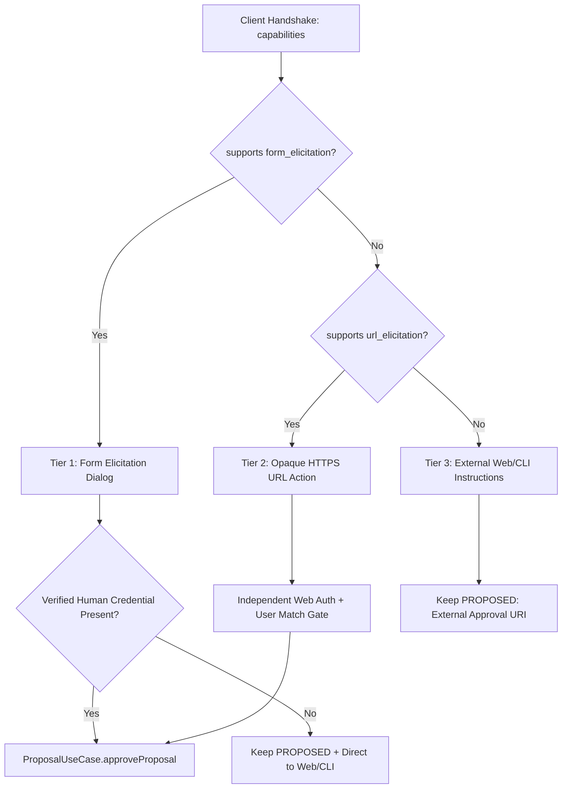

# 🛡️ MCP Gateway & Human-in-the-Loop Elicitation Skill

## 1. Identity & Architectural Mantra

This skill governs the design, implementation, security boundaries, and protocol verification of the **Model Context Protocol (MCP) Gateway** and its **Human-in-the-Loop Elicitation Algebra** in the Wallet Service.

> *"The AI agent requests. The MCP gateway interacts. The human authorizes via a trusted, independent mechanism. The financial domain decides and executes. An MCP interaction response is never a financial authorization credential."*

---

## 2. Three-Identity Non-Conflation Taxonomy (`I-MCP-007`)

To prevent identity coercion, privilege escalation, and confused-deputy attacks, the platform enforces strict cryptographic and semantic separation across three orthogonal identities:

```text
┌───────────────────────────┬──────────────────────────────────┬──────────────────────────────────────────┐
│ Identity Role             │ Source / Proof                   │ Permitted Scope                          │
├───────────────────────────┼──────────────────────────────────┼──────────────────────────────────────────┤
│ 1. Transport Principal    │ HTTP Bearer Token / Gateway Cert │ Accessing /mcp HTTP stream and tooling.  │
│ 2. Agent Client           │ LLM Runtime / Tool Invocation    │ Proposing actions, querying read tools.  │
│ 3. Human Authorizer       │ Authenticated Account Owner      │ Authorizing financial proposal mutations.│
└───────────────────────────┴──────────────────────────────────┴──────────────────────────────────────────┘
```

- **Inviolable Rule**: An Agent Client (`accept`, `confirmed: true`, or form response) can NEVER authorize or approve a proposal on behalf of the Human Authorizer (`I-MCP-002`, `I-MCP-007`).
- The Gateway must verify the independent, authenticated Human Authorizer before invoking `ProposalUseCase.approveProposal()`. If the interaction channel cannot prove the human identity, the proposal remains in `PROPOSED` and directs the user to authenticated Web/CLI.

---

## 3. Transport Topology & Session Semantics

Spring AI MCP supports two HTTP transport modes:

```text
┌──────────────────────────┬─────────────────────────────────┬──────────────────────────────────────────┐
│ Transport Mode           │ Protocol Behavior               │ Elicitation & Server-Initiated Support   │
├──────────────────────────┼─────────────────────────────────┼──────────────────────────────────────────┤
│ STREAMABLE (Stateful)    │ Long-lived Streamable HTTP SSE  │ Full support: Server pushes Form/URL     │
│                          │ with session affinity           │ elicitation and MRTR back to client.     │
├──────────────────────────┼─────────────────────────────────┼──────────────────────────────────────────┤
│ STATELESS (Request/Resp) │ Pure HTTP POST request/response │ Tools only; NO server-initiated pushes;  │
│                          │ No server-side session affinity │ Elicitation degrades to external URI.    │
└──────────────────────────┴─────────────────────────────────┴──────────────────────────────────────────┘
```

- **Configuration**: When interactive elicitation is enabled, configure `spring.ai.mcp.server.protocol: STREAMABLE`.
- **Protocol Envelopes**: Spring AI owns the JSON-RPC 2.0 framing and standard MCP schemas. Application code defines domain records and tool schemas, avoiding synthetic protocol wrappers.

---

## 4. Three-Tier Capability Negotiation Matrix (`REQ-MCP-005`)

Clients declare capabilities during MCP handshake (`initialize`). The Gateway evaluates them deterministically:



---

## 5. Anti-Bearer URL Elicitation Security Contract (`I-MCP-003`)

To comply with MCP URL Elicitation specification and eliminate bearer link vulnerabilities:
1. **Opaque Correlation Token**: Tokens must be high-entropy, short-lived (e.g. 5 minutes), single-use, and stored ephemerally.
2. **Zero Information Leakage**: URLs contain strictly the opaque correlation token over HTTPS (`https://wallet.bank/copilot/approve?token=...`). Zero account IDs, tenant IDs, or amounts in query parameters.
3. **No Pre-Authentication**: Consuming or opening the URL confers ZERO access rights. The landing page requires independent authentication of the human principal.
4. **Subject Matching Gate**: The authenticated web principal must match the authorized account owner of the proposal. If mismatched, return HTTP 403 Forbidden.
5. **Action Non-Equivalence**: Accessing or viewing the URL does NOT approve the proposal. Approval requires an explicit, authenticated user action.

---

## 6. Multi-Instance & Ephemeral Resumption Algebra (`I-MCP-004`)

- `McpInteractionTracker` stores transient mapping `correlationId -> (tenantId, principal, proposalId, createdAt)`.
- **Multi-Instance Semantics**: If an elicitation response arrives at another instance or if the pod restarts:
  - Correlation lookup fails (`CORRELATION_LOST`).
  - The Gateway safely responds with an error directing the user to complete authorization via Web/CLI.
  - **Invariants**: Resumption failure NEVER creates a duplicate proposal, NEVER extends proposal TTL, and NEVER invokes duplicate downstream execution.

---

## 7. Tool-Level Idempotency & Canonical Normalization (`I-MCP-006`)

1. **Scope**: All mutation tools require `idempotencyKey`, evaluated within `(tenantId, idempotencyKey)`.
2. **Canonical Payload Normalization**:
   - Monetary values formatted as canonical strings with scale 2 (`^[0-9]+\.[0-9]{2}$`), bounded in $[0.01, 100000000.00]$, converted directly to `BigDecimal`.
   - Field ordering and whitespace normalized before computing `parameters_hash`.
3. **Deterministic Responses**:
   - Exact match $\to$ returns existing proposal entity.
   - Conflicting payload $\to$ returns error/conflict; never overwrites or re-executes.
   - Concurrent calls $\to$ serialize cleanly through PostgreSQL unique index.

---

## 8. Verification & Security Test Triads (`I-TDD-002`)

Every MCP Gateway capability requires the **Mandatory Test Triad**:
1. **Canonical Positive Path**: Authenticated handshake $\to$ tool invocation with valid params $\to$ returns correct domain projection or proposal.
2. **Boundary & Validation Gate**: Unauthenticated `/mcp` call $\to$ 401/403; tool param tenant override blocked; negative amount or scale $> 2$ rejected; invalid token rejected.
3. **Security Invariant Gate**: Agent `accept` without human credentials maintains proposal in `PROPOSED`; URL opened by different user cannot approve; pod restart/tracker loss falls back safely without duplicating execution.
