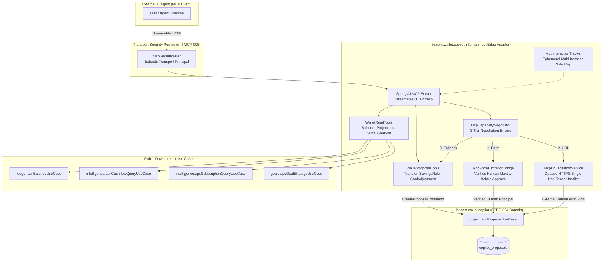

# 📐 Architecture Plan: PLAN-004.1 — MCP Gateway & Human Interaction

- **Associated Spec**: [`../SPEC-004.1-mcp-gateway-and-human-interaction.md`](file:///.spec/SPEC-004.1-mcp-gateway-and-human-interaction.md)
- **Status**: 📝 Ready for Tasks (Ratified per History 104)
- **Author**: Antigravity Orchestrator & System Architect
- **Date**: 2026-10-09
- **Target Release / Milestone**: Wallet Service V4 — Phase 4.1
- **Bounded Context / Package**: `br.com.wallet.copilot.internal.mcp` (under `br.com.wallet.copilot`)
- **Scope Budget**: Max 250 lines (`I-SDD-006`)

---

## 1. Technical Strategy & Component Topology

`PLAN-004.1` implements the **Spring AI MCP Gateway** as an edge protocol adapter in `br.com.wallet.copilot.internal.mcp`. It exposes the platform to external AI agents via Streamable HTTP with stateful session support (`spring.ai.mcp.server.protocol: STREAMABLE`). The gateway isolates read-only tools and mutation proposal tools, orchestrating interactive MCP Elicitation and MRTR, while delegating financial lifecycle and authorization exclusively to `SPEC-004` (`copilot.api.ProposalUseCase`).



---

## 2. Core Architectural Decisions (ADRs)

### ADR-004.1.1: Modulith Packaging & Public Contracts (`I-MCP-001`, `I-AI-003`)
- All MCP classes reside strictly in `br.com.wallet.copilot.internal.mcp.*`. `copilot.api` has zero MCP/Spring AI imports.
- Consumes public contracts:
  - `"ledger::api"`: `BalanceUseCase.getBalance(walletId)` (read tool).
  - `"goals::api"`: `GoalStrategyUseCase.simulate(...)` (stateless simulation read tool).
  - `"intelligence::api"`: `CashflowQueryUseCase.getProjections(...)` and `SubscriptionQueryUseCase.getSubscriptions(...)` (read tools). Reconciled in `intelligence.api` with `@NamedInterface("api")`.
  - `"core::api"`: `TenantContextMissingException` (security filter) and `OperationOrigin.AGENT`.
  - `"savings::api"`: Retained by Copilot domain for `DownstreamExecutionBridge`.

### ADR-004.1.2: Three-Identity Non-Conflation Gate (`I-MCP-005`, `I-MCP-007`)
- The architecture isolates three distinct identities:
  1. **Transport Principal**: Bearer credential authenticating the HTTP `/mcp` request.
  2. **Agent Client**: External LLM runtime executing tools.
  3. **Human Authorizer**: Account owner possessing legal authority to authorize financial mutations.
- **Enforcement**: Receiving `accept` from an MCP client is strictly an interaction response, never an authorization credential. The gateway NEVER approves a proposal unless verified human credentials accompany the request. If unverified, the gateway directs the user to the authenticated web/CLI approval flow.

### ADR-004.1.3: Anti-Bearer URL Elicitation Security Contract (`REQ-MCP-008`, `I-MCP-003`)
- URL Elicitation generates an opaque, single-use, high-entropy correlation token over HTTPS (`https://wallet.bank/copilot/approve?token=...`).
- Zero PII, account IDs, or financial amounts in URL parameters.
- Consuming or opening the URL confers ZERO access rights. The approval landing page requires independent authentication, verifies that the authenticated user matches the proposal's authorized user, and requires explicit user approval.
- Expired or reused tokens are rejected with HTTP 403 Forbidden.

### ADR-004.1.4: Multi-Instance Safe Ephemeral Tracking & Resumption (`I-MCP-004`)
- `McpInteractionTracker` stores transient mapping `correlationId -> (tenantId, principal, proposalId, createdAt)`.
- If an elicitation response arrives at another instance or pod restarts, correlation fails safe (`CORRELATION_LOST`) and directs to Web/CLI.
- **Fail-Closed Invariants**: State loss NEVER creates duplicate proposals, NEVER extends proposal TTL, and NEVER triggers duplicate downstream execution.

### ADR-004.1.5: Tool Idempotency & Precision Invariants (`I-MCP-006`, `I-TDD-002`)
- **Precision**: String matching `^[0-9]+\.[0-9]{2}$`, validated within $[0.01, 100000000.00]$, converted directly to `BigDecimal`.
- **Idempotency**: Scoped to `(tenantId, idempotencyKey)`. Identical payload returns existing proposal. Conflicting payload returns HTTP 409 Conflict without modifying proposal. Concurrent requests serialize via database unique constraint.

### ADR-004.1.6: Protocol Framing & Native Spring AI Envelopes (`REQ-MCP-001`)
- Spring AI owns JSON-RPC framing and standard MCP schemas. Application defines domain records. Custom synthetic protocol envelopes (e.g. `McpToolResponse.java`) are eliminated to prevent spec drift.

---

## 3. Spring Modulith Topology & Packaging

```text
br.com.wallet.copilot
├── package-info.java                   (@ApplicationModule with ledger, goals, intelligence, core, savings)
├── api/                                (Existing public contracts - zero MCP leaks)
└── internal/
    ├── service/                        (ProposalService, Bridge, Reconciler)
    ├── dao/                            (ProposalDao)
    ├── rest/                           (ProposalController)
    └── mcp/                            (MCP Gateway Adapter Tier)
        ├── config/
        │   ├── McpServerConfiguration.java     (Spring AI Streamable HTTP endpoint)
        │   └── McpSecurityFilter.java          (Transport auth, principal extraction)
        ├── tools/
        │   ├── WalletReadTools.java            (Balance, Projections, Subscriptions, GoalSim)
        │   └── WalletProposalTools.java        (Transfer, SavingsRule, GoalAdjustment)
        ├── elicitation/
        │   ├── McpCapabilityNegotiator.java    (3-tier negotiation engine)
        │   ├── McpFormElicitationBridge.java   (Human verification -> approveProposal)
        │   └── McpUrlElicitationService.java   (Opaque single-use HTTPS token generator)
        ├── interaction/
        │   └── McpInteractionTracker.java      (Multi-instance safe ephemeral correlation)
        └── model/
            └── McpClientCapabilities.java      (Extracted client capabilities)
```

---

## 4. Interaction Lifecycle & Resumption Algebra

```text
1. Agent Invocation: callTool(copilot_propose_transfer, {source, target, amount, idempotencyKey})
2. Gateway Ingress: McpSecurityFilter validates Transport Principal (rejects tool tenant overrides).
3. Proposal Creation: calls ProposalUseCase.createProposal(...) -> persists copilot_proposal (PROPOSED).
4. Capability Check:
   ├─► Form Elicitation: emits input_required -> interaction accept -> gateway verifies human -> approveProposal().
   │   └─► Unverified human: maintains PROPOSED + emits Web/CLI approval instructions.
   ├─► URL Elicitation: emits MCP URL action with opaque token -> external human auth -> approveProposal().
   └─► Neither / Fallback: returns tool result with proposalId and external approval URI (PROPOSED).
5. Downstream Execution: SPEC-004 claims atomic lease, executes downstream, transitions to EXECUTED.
```

---

## 5. Traceability Matrix (`SPEC-004.1` $\longrightarrow$ `PLAN-004.1`)

### 5.1 Requirements Traceability
| Requirement ID | Architectural Component | Verification Target |
| :--- | :--- | :--- |
| `REQ-MCP-001` | `McpServerConfiguration`, `McpSecurityFilter` | `McpServerSecurityTest` (unauthenticated $\to$ 401/403) |
| `REQ-MCP-002` | `WalletReadTools` | `WalletReadToolsTest` (cross-tenant 404, non-locking reads) |
| `REQ-MCP-003` | `WalletProposalTools` | `WalletProposalToolsTest` (mandatory key, scale-2 $[0.01, 10^8]$) |
| `REQ-MCP-004` | `McpSecurityFilter`, `WalletProposalTools` | `McpSecurityFilterTest` (tool param override blocked) |
| `REQ-MCP-005` | `McpCapabilityNegotiator` | `McpCapabilityNegotiatorTest` (Form vs URL vs fallback) |
| `REQ-MCP-006` | `McpFormElicitationBridge` | `McpFormElicitationBridgeTest` (agent accept rejected without human) |
| `REQ-MCP-007` | `McpInteractionTracker` | `McpInteractionTrackerTest` (multi-instance state loss safe) |
| `REQ-MCP-008` | `McpUrlElicitationService` | `McpUrlElicitationServiceTest` (opaque single-use HTTPS token) |

### 5.2 Invariants Traceability
| Invariant ID | Description | Verification Method |
| :--- | :--- | :--- |
| **`I-MCP-001`** | Zero MCP/Spring AI imports in `copilot.api` | `ModulithArchitectureTest.verifyArchitecture()` |
| **`I-MCP-002`** | Unsupported elicitation falls back; never auto-executes | `McpCapabilityNegotiatorTest.testUnsupportedDegradesToExternal()` |
| **`I-MCP-003`** | Zero credentials in forms; opaque single-use URL tokens | `McpUrlElicitationServiceTest.testOpaqueTokenSecurity()` |
| **`I-MCP-004`** | MRTR timeout/disconnect leaves proposal TTL untouched | `McpInteractionTrackerTest.testDisconnectionPreservesProposalTtl()` |
| **`I-MCP-005`** | Transport auth; tool param tenant override blocked | `McpSecurityFilterTest.testTenantOverrideBlocked()` |
| **`I-MCP-006`** | String scale 2 amount in $[0.01, 10^8]$; mandatory key | `WalletProposalToolsTest.testMonetaryPrecisionValidation()` |
| **`I-MCP-007`** | Three-Identity Isolation: Agent cannot approve for human | `McpFormElicitationBridgeTest.testAgentCannotApprove()` |
