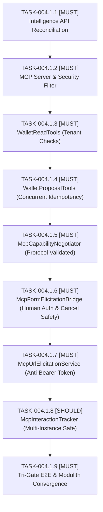

# 📋 Task Breakdown: TASKS-004.1 — MCP Gateway & Human Interaction

- **Associated Spec & Plan**: [`../SPEC-004.1-mcp-gateway-and-human-interaction.md`](file:///.spec/SPEC-004.1-mcp-gateway-and-human-interaction.md), [`../plans/PLAN-004.1-mcp-gateway-and-human-interaction.md`](file:///.spec/plans/PLAN-004.1-mcp-gateway-and-human-interaction.md)
- **Status**: ✅ Completed & Verified (Tri-Gate Convergence Passed)
- **Author**: Antigravity Orchestrator & System Architect
- **Target Milestone**: Wallet Service V4 — Phase 4.1
- **Scope Budget**: Max 250 lines (`I-SDD-006`). Strict MoSCoW (`I-SDD-004`: `[MUST]` tasks first).

---

## 1. MoSCoW Prioritization & Task Sequence

---

## 2. Active Task Cards

### [x] `TASK-004.1.1` [MUST] [GREEN]: Intelligence API Reconciliation & Modulith Contracts
- **Scope**: Inspect existing `intelligence` services (`CashflowForecastingService`, `SubscriptionDao`). Declare public `CashflowQueryUseCase` & `SubscriptionQueryUseCase` in `br.com.wallet.intelligence.api` (`@NamedInterface("api")`). Implement `SubscriptionQueryService` delegating to `SubscriptionDao`. Update `copilot/package-info.java` to declare `"intelligence::api"`.
- **Target Files**:
  - `src/main/java/br/com/wallet/intelligence/api/CashflowQueryUseCase.java`
  - `src/main/java/br/com/wallet/intelligence/api/SubscriptionQueryUseCase.java`
  - `src/main/java/br/com/wallet/intelligence/api/package-info.java`
  - `src/main/java/br/com/wallet/intelligence/internal/service/SubscriptionQueryService.java`
  - `src/main/java/br/com/wallet/copilot/package-info.java`
- **TDD Triad (`I-TDD-002`)**:
  - *Positive*: Projections and subscriptions query returns active items for tenant/wallet.
  - *Boundary*: Cross-tenant wallet returns safe empty list without leaking other tenants.
  - *Architecture*: Modulith test proves `copilot` depends only on `intelligence::api`.

### [x] `TASK-004.1.2` [MUST] [GREEN]: MCP Server Configuration & Transport Security Perimeter
- **Scope**: Configure Spring AI MCP Server utilizing Streamable HTTP (`STREAMABLE` protocol mode). Implement `McpSecurityFilter` asserting Transport Principal, binding authenticated `TenantContext`, preventing tool argument tenant overrides, and enforcing that transport principal $\ne$ account owner (`REQ-MCP-001`, `REQ-MCP-004`, `I-MCP-005`).
- **Target Files**:
  - `src/main/java/br/com/wallet/copilot/internal/mcp/config/McpServerConfiguration.java`
  - `src/main/java/br/com/wallet/copilot/internal/mcp/config/McpSecurityFilter.java`
- **TDD Triad (`I-TDD-002`)**:
  - *Positive*: Authenticated Bearer request initializes Streamable HTTP session and populates `SecurityContext`.
  - *Boundary*: Unauthenticated request to `/mcp` returns HTTP 401/403.
  - *Security Gate*: Request attempting tool parameter tenant override is blocked/ignored (`testTenantOverrideBlocked`).

### [x] `TASK-004.1.3` [MUST] [GREEN]: WalletReadTools Implementation
- **Scope**: Implement read-only MCP tool catalog (`wallet_get_balance`, `wallet_get_cashflow_projections`, `wallet_get_active_subscriptions`, `wallet_simulate_goal_strategy`) asserting resource tenant ownership before calling downstream use cases (`REQ-MCP-002`, `I-MCP-001`).
- **Target Files**:
  - `src/main/java/br/com/wallet/copilot/internal/mcp/tools/WalletReadTools.java`
- **TDD Triad (`I-TDD-002`)**:
  - *Positive*: Queries for balance, projections, subscriptions, and goal simulation succeed for owner.
  - *Boundary*: Cross-tenant wallet query throws `AccountNotFoundException` / 404 (`I-AI-004`).
  - *Invariant Gate*: Zero direct DB queries; simulation does not invoke mutation methods (`I-MCP-001`).

### [x] `TASK-004.1.4` [MUST] [GREEN]: WalletProposalTools Implementation & Concurrent Idempotency
- **Scope**: Implement mutation proposal tools (`copilot_propose_transfer`, `copilot_propose_savings_rule`, `copilot_propose_goal_adjustment`) delegating to `ProposalUseCase.createProposal` (`REQ-MCP-003`, `I-MCP-006`). Enforce scale-2 $[0.01, 10^8]$ bounds and persistent concurrent idempotency on `(tenantId, idempotencyKey)`.
- **Target Files**:
  - `src/main/java/br/com/wallet/copilot/internal/mcp/tools/WalletProposalTools.java`
- **TDD Triad (`I-TDD-002`)**:
  - *Positive*: Valid transfer tool call creates proposal in `PROPOSED` status.
  - *Boundary*: Negative amount, scale $> 2$, or missing idempotency key rejected before calling domain.
  - *Idempotency Gate*: Replaying same key returns existing proposal; conflicting payload returns 409; concurrent simultaneous calls converge on exactly one proposal (`I-MCP-006`).

### [x] `TASK-004.1.5` [MUST] [GREEN]: Three-Tier McpCapabilityNegotiator
- **Scope**: Inspect client capabilities during handshake for `form_elicitation` and `url_elicitation` using MCP specification metadata schemas. Determine interaction tier with deterministic fallback (`REQ-MCP-005`, `I-MCP-002`).
- **Target Files**:
  - `src/main/java/br/com/wallet/copilot/internal/mcp/elicitation/McpCapabilityNegotiator.java`
  - `src/main/java/br/com/wallet/copilot/internal/mcp/model/McpClientCapabilities.java`
- **TDD Triad (`I-TDD-002`)**:
  - *Positive*: Form-capable routes to Tier 1; URL-capable routes to Tier 2.
  - *Boundary*: Empty or unsupported capabilities gracefully degrade to Tier 3 external instructions.
  - *Invariant Gate*: Unsupported client returns proposal in `PROPOSED` with external URI; zero auto-execution (`I-MCP-002`).

### [x] `TASK-004.1.6` [MUST] [GREEN]: McpFormElicitationBridge & Human Verification Gate
- **Scope**: Interactive Form Elicitation handler. Enforce Three-Identity Non-Conflation: agent `accept` cannot approve without verified human credentials. Handle `accept` (requires verified human), `decline` (explicit reject), and `cancel` (ends interaction, keeps `PROPOSED` without auto-rejecting) (`REQ-MCP-006`, `I-MCP-002`, `I-MCP-007`).
- **Target Files**:
  - `src/main/java/br/com/wallet/copilot/internal/mcp/elicitation/McpFormElicitationBridge.java`
- **TDD Triad (`I-TDD-002`)**:
  - *Positive*: Verified human credentials confirm form $\to$ dispatches to `approveProposal`.
  - *Boundary*: Form `decline` transitions to `REJECTED`; `cancel` closes interaction keeping proposal in `PROPOSED`.
  - *Security Gate*: Agent sends `accept` without verified human credentials $\to$ proposal stays `PROPOSED` (`testAgentCannotApprove`).

### [x] `TASK-004.1.7` [MUST] [GREEN]: McpUrlElicitationService & Anti-Bearer Security
- **Scope**: Emits single-use opaque HTTPS correlation tokens (`https://.../approve?token=...`). Independent web authentication, subject matching gate (`userId == proposal.userId`), and replay protection (`REQ-MCP-008`, `I-MCP-003`).
- **Target Files**:
  - `src/main/java/br/com/wallet/copilot/internal/mcp/elicitation/McpUrlElicitationService.java`
- **TDD Triad (`I-TDD-002`)**:
  - *Positive*: Valid token with matching human user allows explicit approval.
  - *Boundary*: Expired or reused token returns HTTP 403 Forbidden.
  - *Security Gate*: Authenticated user different from proposal owner rejected with 403 (`testCrossUserUrlApprovalRejected`).

### [x] `TASK-004.1.8` [SHOULD] [GREEN]: McpInteractionTracker & Multi-Instance Resumption
- **Scope**: Multi-instance safe ephemeral tracking for MRTR interactions. Safe fail-closed handling of pod restarts and lost state (`REQ-MCP-007`, `I-MCP-004`).
- **Target Files**:
  - `src/main/java/br/com/wallet/copilot/internal/mcp/interaction/McpInteractionTracker.java`
- **TDD Triad (`I-TDD-002`)**:
  - *Positive*: Reconnected client within active session resumes pending interaction.
  - *Boundary*: Lost correlation returns `CORRELATION_LOST` directing user to Web/CLI.
  - *Invariant Gate*: Disconnect or restart leaves proposal TTL untouched; zero duplicate proposals created (`I-MCP-004`).

### [x] `TASK-004.1.9` [MUST] [GREEN]: Tri-Gate E2E & Architecture Convergence
- **Scope**: Structured three-gate convergence verification: Gate A (Architecture & Transport), Gate B (Three-Identity Authorization & Concurrent Idempotency), Gate C (Elicitation Interaction Flows & Resumption) (`I-SDD-002`, `I-SDD-003`).
- **Target Files**:
  - `src/test/java/br/com/wallet/copilot/internal/mcp/McpIntegrationSecurityTest.java`
  - `src/test/java/br/com/wallet/ModulithArchitectureTest.java`
- **TDD Triad (`I-TDD-002`)**:
  - *Gate A*: Modulith architecture verification passes with zero dependency leaks (`I-MCP-001`).
  - *Gate B*: Unauthenticated call rejected, agent spoofing prevented, concurrent idempotency verified.
  - *Gate C*: Form accept/decline/cancel verified, URL opaque token security verified, state loss fallback verified.
